# Orbit Orchard

A gravity-slingshot puzzle for the browser. Pull back, let go, and steer seeds around planets, suns and black holes until every patch of fertile soil in the sky has taken root.

[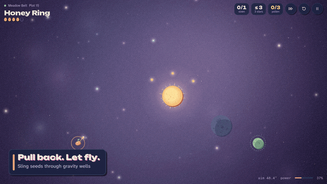](docs/media/trailer.mp4)

▶ [Watch the full trailer (MP4)](docs/media/trailer.mp4)

## Play now

| Where | Link | Notes |
|---|---|---|
| Web | **https://orbit-orchard.web.app** | Sign in with Google for cloud save and Friends. Works offline after the first visit. |
| claude.ai artifact | **https://claude.ai/artifact/7xhNrpRWfS1SAZMM1EE776** | Cloud save and Friends work only for people in the artifact owner's organization. |

Both run the same game on desktop (mouse and keyboard) and phones (touch). To run it yourself, see [Running locally](#running-locally-and-deploying).

## Features

**Puzzles**
- 110 hand-made plots across five worlds: Meadow Belt, Frost Reach, Clockwork Orrery, Fold Nebula and Event Horizon. Each world adds one or two new mechanics and ends in a showpiece plot.
- Up to three stars per plot for using few seeds, plus a golden pollen badge for collecting every pollen mote.
- Clearing 16 plots in a world opens the next one.

**Daily play and side modes**
- **Daily Sky**: one generated sky a day, the same for every player. Your first run counts for the streak and a shareable result card; replays are practice.
- **Zen Garden**: endless seeds, no par, five difficulty levels, and a seed number you can share.
- **Almanac**: a field guide that fills in as you meet each kind of body.
- **Greenhouse**: nine beds that grow from what you have done (worlds cleared, golden badges, Perfect clears, Daily streak, Zen skies).
- **Trophies**: 39 trophies from bronze to platinum, grouped into six categories: Journey, Mastery, Sky physics, Daily & Zen, Collection and Friends.

**Nectar and the Market**
- Clears, stars, golden badges, Perfect clears, trophies, the Daily Sky, Zen skies and daily visits all earn nectar.
- Spend it in the Market on the **Oracle** (a Glimpse of a plot's opening shot, or its full clear), spare seeds, frost charms that protect a Daily streak, seed trails, Greenhouse decorations, glazed pots, fertilizer, a title-screen banner and constellation badges.

**Look, sound and comfort**
- Four skins: Nocturne, Daylight, Synthwave and Inkwell. Every world has its own palette, ambience and generative music.
- Accessibility settings: colorblind markers, reduced motion, screen shake on or off, and a trajectory assist that draws a longer preview line.
- A fast-forward button in the HUD, an auto fast-forward setting, and a gravity lattice that shows how space bends.
- On tall screens the field rotates to portrait so seeds fly up the screen.

**Online**
- Cloud save that merges progress between devices.
- Friends: follow people by friend code, read each other's encrypted progress cards, and send challenge skies where the fewest seeds wins.

## How to play

Every plot has one or more **soil** planets (green, ringed). Land a seed on each one, and on hungry soil land as many as its ring segments ask for. The dotted preview line shows where the seed will go for the first second or so of flight, and later worlds shorten it.

### Controls

| Action | Mouse / touch | Keyboard |
|---|---|---|
| Aim and set power | Drag anywhere and pull back like a slingshot. Drag back to the start point to cancel. | <kbd>←</kbd> <kbd>→</kbd> aim, <kbd>↑</kbd> <kbd>↓</kbd> power, hold <kbd>Shift</kbd> for fine steps |
| Sow (launch) | Release the drag | <kbd>Space</kbd> or <kbd>Enter</kbd> |
| Fast-forward a flight | Tap the field while a seed flies, or use the HUD button | Hold <kbd>F</kbd> |
| Gravity lattice | Settings | <kbd>G</kbd> |
| Replant / next plot | Replant button / results card | <kbd>R</kbd> / <kbd>N</kbd> after a win |
| Pause | HUD button | <kbd>Esc</kbd> or <kbd>P</kbd> |
| Mute | Speaker button | <kbd>M</kbd> |
| Snap aim to the Oracle's guide | | <kbd>H</kbd> |
| Switch menu tabs | Tab bar | <kbd>1</kbd> to <kbd>9</kbd> |

The same list is under **Settings > Controls** in the game.

### Stars, Perfect and golden pollen

- Each plot has a **par**, the fewest seeds that can clear it. Clear it in few enough seeds for three stars, a few more for two, or anywhere within your seed pouch for one. The leeway over par shrinks as a world goes on.
- Clearing a plot in exactly par seeds, without the Oracle's guides, earns a **Perfect** mark.
- Gather every golden **pollen** mote in a single attempt for the **golden** badge. Pollen you collect stays collected for the rest of that attempt, so it can take several seeds.
- A clear made with Oracle guides tops out at two stars. The trajectory assist never caps stars; it only tags the result "Assist".

### What's in the sky

| Body | First seen | What it does |
|---|---|---|
| Soil | World 1 | Land a seed anywhere on it to plant. Hungry soil wants more than one seed. |
| Barren rock | World 1 | Nothing grows; its pull still bends your shot. |
| Sun | World 1 | Heavy pull. Whip around it for speed, but touching it scorches the seed. |
| Pollen | World 1 | Optional collectibles for the golden badge. |
| Ice | World 2 | Seeds glance off and keep flying, so you can bank shots. |
| Shield | World 2 | An arc around soil that only lets seeds through its gap. Later ones turn. |
| Orbit | World 3 | Moons circle their parent while you aim, so timing matters. |
| Fold | World 4 | Two joined rings. Enter one, leave the other at the same speed and heading. |
| Wind | World 4 | A band of steady current that pushes anything flying through it. |
| Boost gate | World 4 | Speeds a seed up; some gates also turn it. |
| Black hole | World 5 | Tiny, with a pull that reaches across the plot. Nothing comes back out. |
| Repulsor | World 5 | Pushes seeds away. Touching one still ends the flight. |

### Tips

- Watch where the preview line ends, not just where it starts. A soft pull near the end can still bend a shot onto soil.
- A close pass around a sun adds a lot of speed. Just don't touch it.
- On Clockwork plots the moons keep moving while you aim. Wait for the gap rather than forcing the angle.
- Turn on the gravity lattice (<kbd>G</kbd>) to see which bodies dominate a region of the sky.
- Stuck? Open the pause menu and buy a Glimpse. It plays the opening shot and leaves an aim guide behind.

## Screenshots

<table>
  <tr>
    <td width="50%">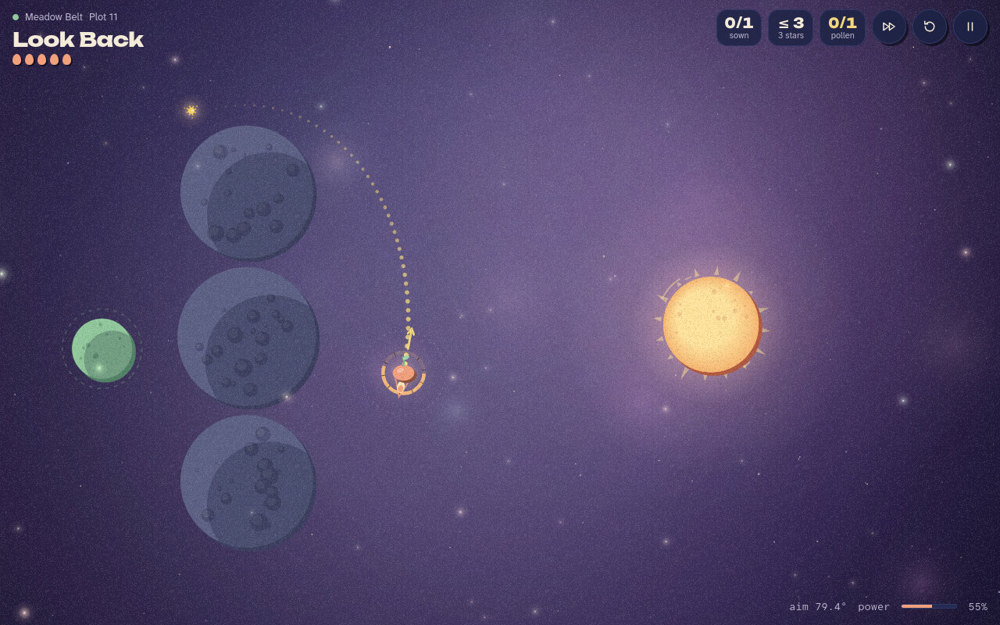<br><sub>Aiming: the preview line bends around the rocks</sub></td>
    <td width="50%">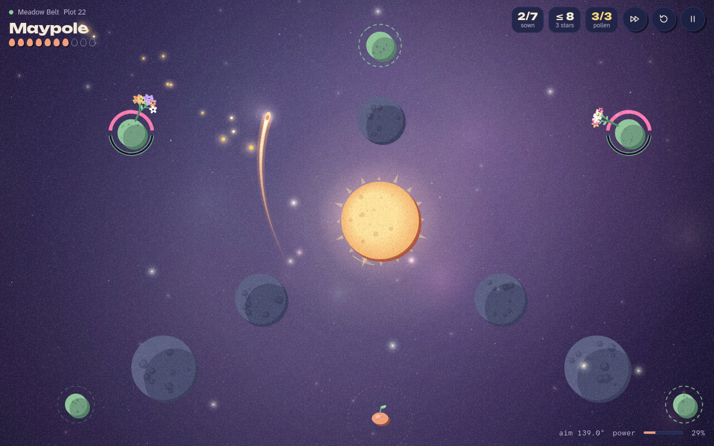<br><sub>Mid-flight on Maypole, the Meadow Belt finale</sub></td>
  </tr>
  <tr>
    <td>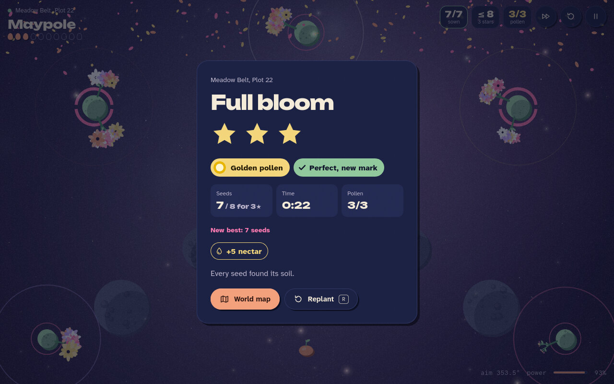<br><sub>A three-star clear with golden pollen and Perfect</sub></td>
    <td>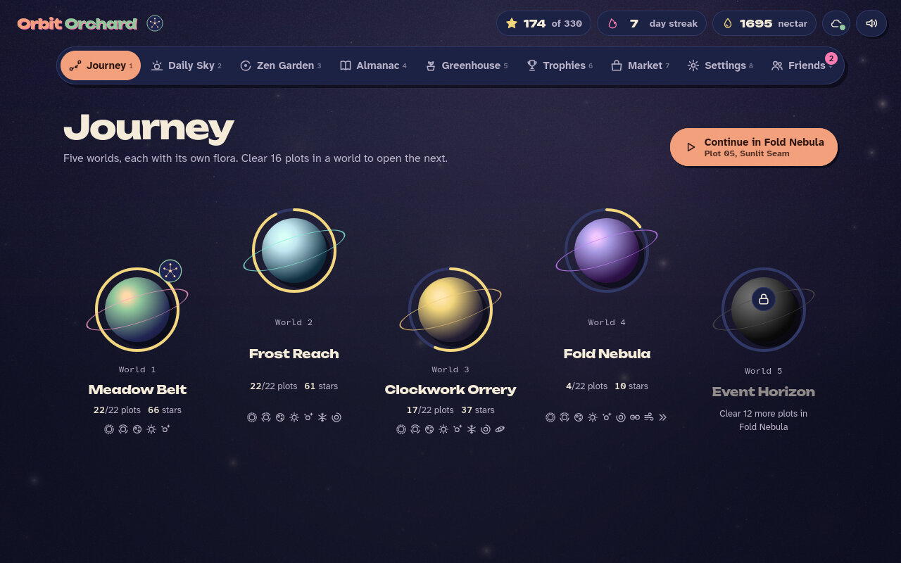<br><sub>The Journey map</sub></td>
  </tr>
  <tr>
    <td>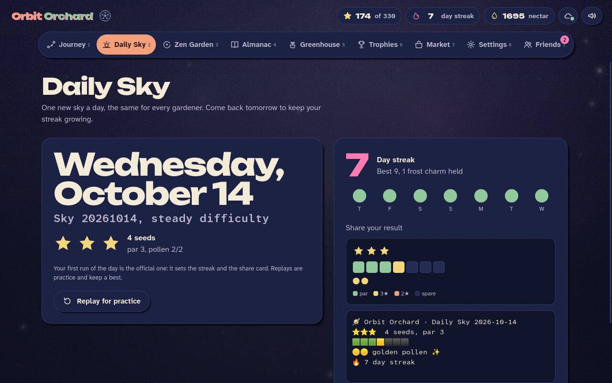<br><sub>Daily Sky with a streak and share card</sub></td>
    <td>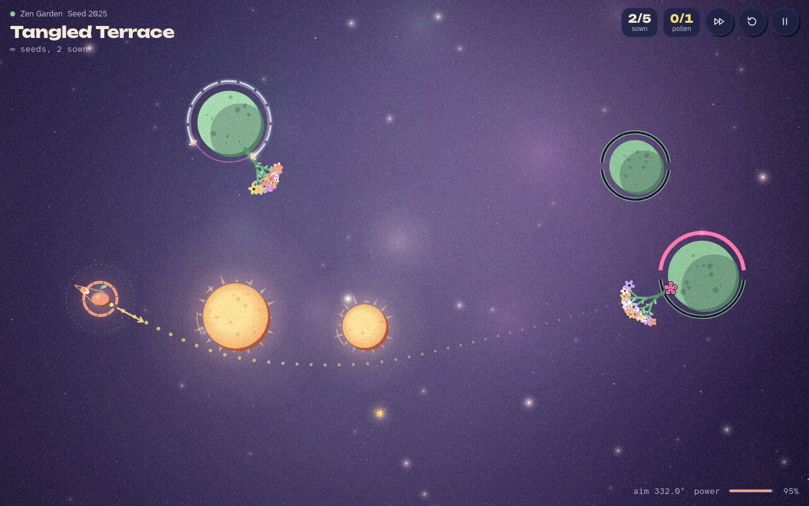<br><sub>A Zen Garden sky</sub></td>
  </tr>
  <tr>
    <td>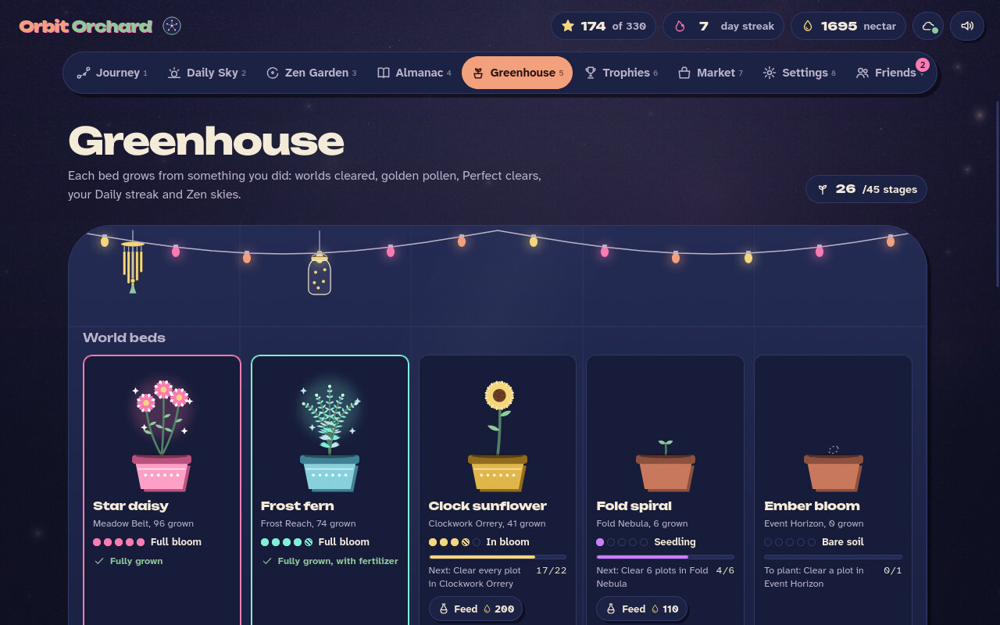<br><sub>The Greenhouse</sub></td>
    <td>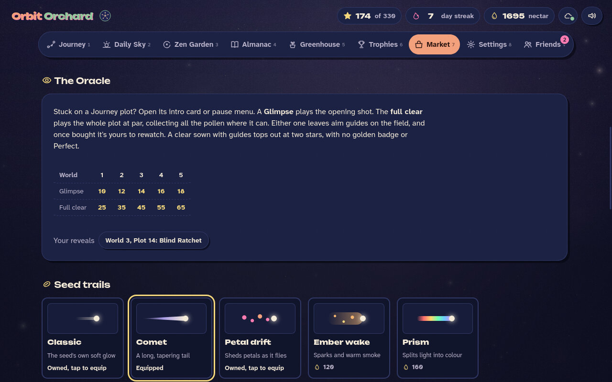<br><sub>The Market and the Oracle</sub></td>
  </tr>
  <tr>
    <td>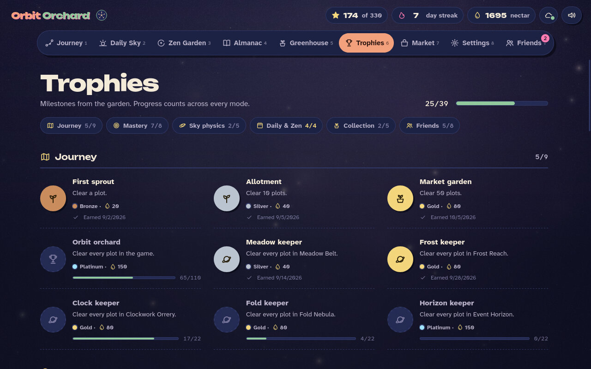<br><sub>Trophies in six categories</sub></td>
    <td>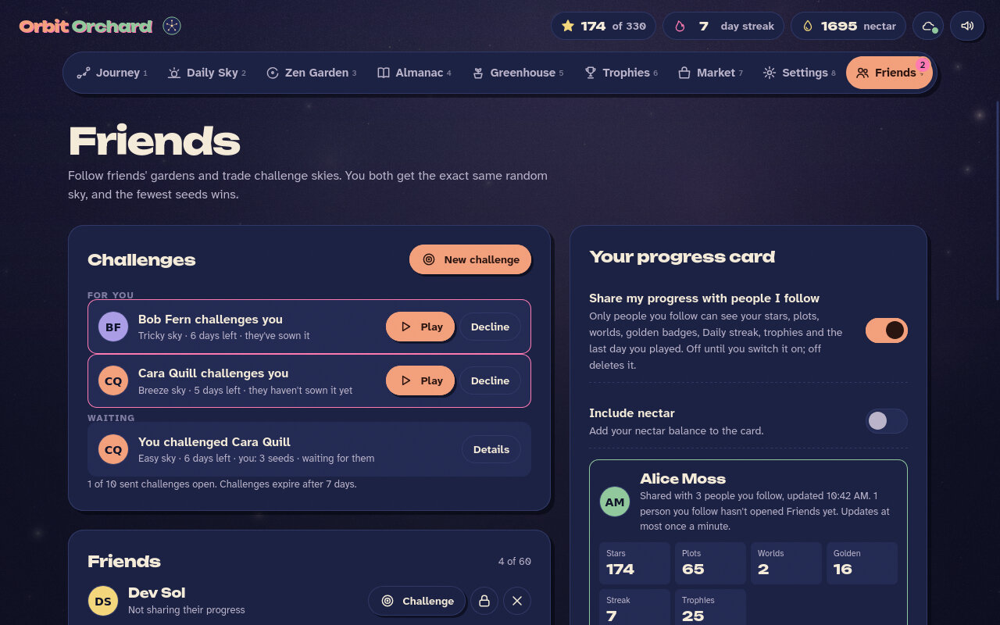<br><sub>Friends: challenges and your progress card</sub></td>
  </tr>
  <tr>
    <td>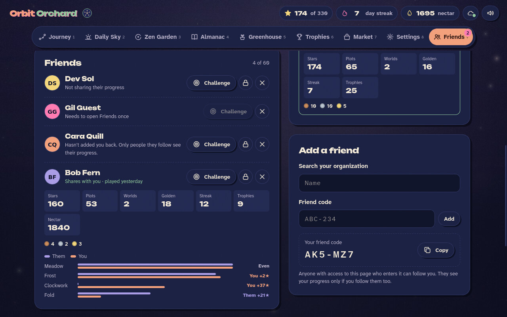<br><sub>A friend's progress card, compared world by world</sub></td>
    <td align="center">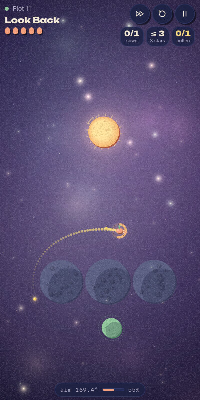<br><sub>On a phone the field turns to portrait</sub></td>
  </tr>
</table>

## Friends and cloud save

**Cloud save.** The game always saves in the browser first and syncs in the background, so it keeps working offline. On claude.ai the save goes to your private storage in the artifact. On the web it goes to your Google account in Cloud Firestore. Signing in merges this device's progress with the cloud copy: best results win, and nectar and trophies from both sides are kept.

**Friends.** Add someone with their six-character friend code. Following is one-way, up to 60 people.
- **Progress cards** show stars, plots, worlds, golden badges, Daily streak and trophies, plus nectar only if you switch that on. Sharing is off until you turn it on, and turning it off deletes your card.
- **Challenges** send a friend a generated sky. You both play the same sky; fewest seeds wins, then more pollen, then less time. A challenge lasts seven days, and recorded results pay a little nectar.

**Privacy.**
- Cards and challenges are end-to-end encrypted (ECDH P-256 key agreement, AES-GCM). Only the people you follow can open your card, and only the two players in a challenge can read it. Shared documents hold only ciphertext; your own friend list and challenge history stay in your private storage.
- Each friend has a safety code you can compare to confirm their key. If a friend's key changes, the game pauses sharing with them until you accept the new one.
- On the web build your Google display name is shown to friends by default. You can switch "Show my Google name to friends" off, and friends then see "Gardener" plus your friend code.
- On the web build the Firebase project owner can see who follows whom, and when cards were written, but not what is in them.

**Cloud limits on the web.** To stay within Firebase's free quota, each player gets a daily cloud allowance. If it runs out, the game keeps saving on the device and syncs again after midnight Pacific time. The numbers are in [firebase/SETUP.md](firebase/SETUP.md#daily-allowance).

## Running locally and deploying

- **Quick look:** open `orbit-orchard.html` in a browser. It is an HTML fragment written for claude.ai artifacts, so for a standards-mode page, wrap it first:

  ```sh
  (echo '<!doctype html><html><head><meta charset="utf-8"><meta name="viewport" content="width=device-width,initial-scale=1"></head><body>'; cat orbit-orchard.html; echo '</body></html>') > dev/preview.html
  ```

  Progress stays in the browser's local storage. Cloud save and Friends need claude.ai or the Firebase build.
- **Your own Firebase site:** `sh firebase/build.sh` writes the site to `firebase/public/`. Creating the project, filling in `js/firebase-config.js`, deploying and running the emulators are covered in [firebase/SETUP.md](firebase/SETUP.md).

## Project layout

```
orbit-orchard.html     page shell, styles and script list (the claude.ai artifact)
js/sim.js              deterministic physics shared by the game and the solver
js/levels/w1.js…w5.js  the five worlds and their 110 plots
js/game.js             canvas renderer, input, gameplay, Zen and Daily sky generator
js/ui.js               menus, HUD, progression, nectar, trophies, saving, settings
js/audio.js            sound effects and generative music (WebAudio)
js/solutions.js        Oracle solutions for every plot
js/cloud.js            cloud save sync and merge
js/friends.js          Friends, progress cards and challenges
js/*-web.js, js/backend-firebase.js, css/web.css   web build additions
firebase/              build script, Firestore rules, service worker, SETUP.md
tools/                 level solver and solution checks
dev/                   test harnesses and screenshot scripts (dev/readme makes the shots above)
```

## Tests

Node test suites, browser harnesses and the Firestore rules tests are listed in [CONTRACT.md](CONTRACT.md), which also documents the game's APIs and data formats.
